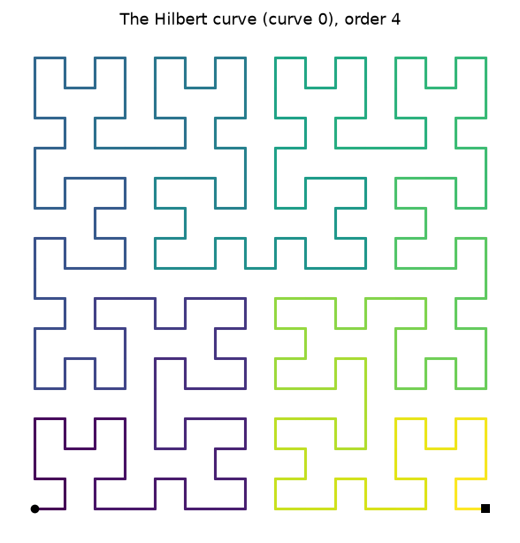
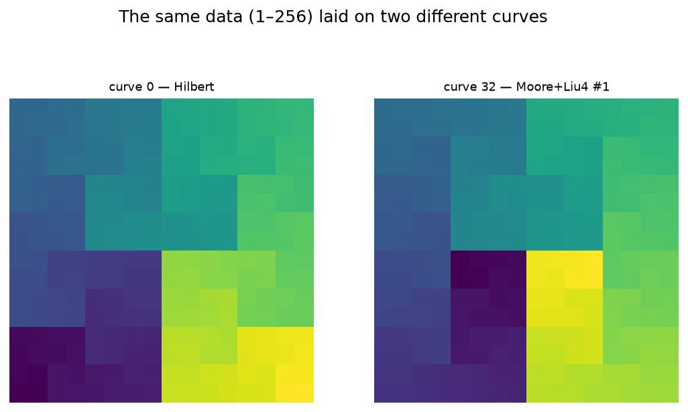
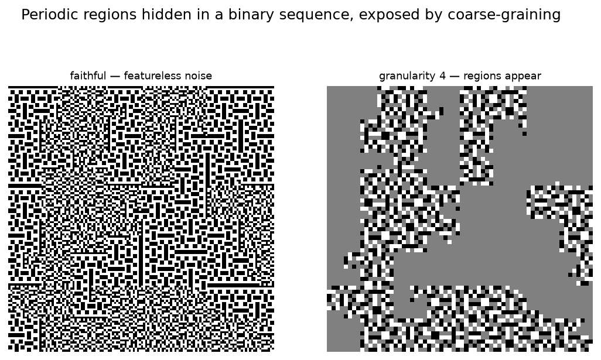
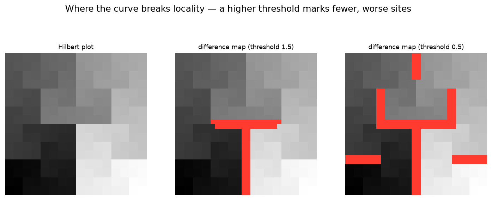
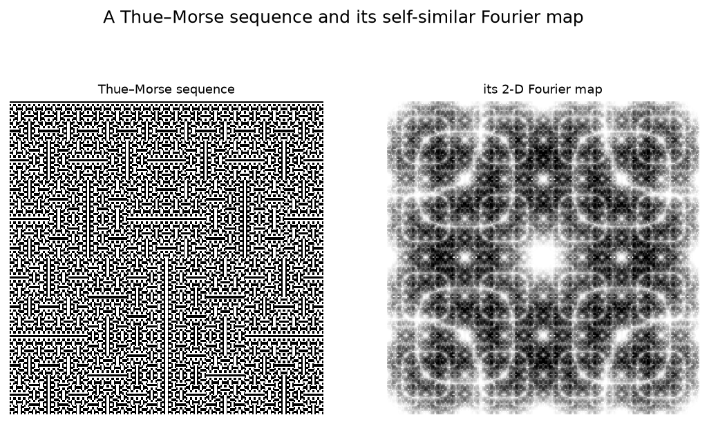

# hilbertplot

[](https://pypi.org/project/hilbertplot/)
[](https://github.com/El3ssar/hilbertplot/actions/workflows/ci.yml)
[](https://pypi.org/project/hilbertplot/)
[](https://github.com/El3ssar/hilbertplot/blob/main/LICENSE)

The **complete set of 40 two-dimensional Hilbert curves** — and a fast way to plot long
1-D data on any of them.

Most software knows one Hilbert curve. In fact there are **forty** distinct space-filling
curves of Hilbert type in two dimensions (up to rotation, reflection and reversion), as
proved by Estevez-Rams et al., *"Hilbert curves in two dimensions"*, Rev. Cub. Fís. **34**,
9 (2017). `hilbertplot` implements all forty with pure-numpy generation and uses them to lay
long 1-D vectors onto 2-D images.

<p align="center">
  
</p>

## Install

```bash
pip install "hilbertplot[plot]"   # drop [plot] for a numpy-only core (no matplotlib)
```

## Draw a curve

```python
import hilbertplot

c = hilbertplot.curve(0)     # by index 0–39, by name ("Moore"), or by symbol
c.show(4)                    # draw order 4 in a window
pts = c.points(4)            # (256, 2) integer lattice points, in visit order
```

The forty curves come in named groups — `hilbertplot.proper()`, `.improper()`,
`.homogeneous()`, `.inhomogeneous()`, `.generalizing()` — each of which prints as a table,
and which compose:

```python
import hilbertplot

print(hilbertplot.proper())                       # a table of the six proper curves
hilbertplot.catalog().closed().names              # ['Moore', 'Liu1', 'Improper1', 'Improper4']
hilbertplot.by_kernels(3, 5).gallery(order=3)     # draw a group as a grid of panels
```

In a Jupyter notebook a `Curve` renders itself — put `hilbertplot.curve("Moore")` in a cell
and you get the picture, not a `repr`.

## One cell at a time

`points(order)` builds all `4**order` cells. When you only need *where step `i` lands*,
`encode` answers in `O(order)` — so it works at orders no machine could materialise, and it
does so for **all forty** curves, not just the classic one:

```python
import hilbertplot

c = hilbertplot.curve(0)
c.encode(5, 2)                     # (0, 3) — the cell visited at step 5, order 2
c.decode(0, 3, 2)                  # 5      — and back again
c.encode(10**18, 40)               # (751054336, 346100736) — a 2**80-cell curve
```

## Plot data

Walk a curve and drop `data[i]` on the *i*-th cell it visits: a locality-preserving
1-D → 2-D map where nearby values stay nearby.

```python
import numpy as np, hilbertplot

plot = hilbertplot.hilbert_plot(0, np.arange(1, 257))
plot.show("viridis")          # a matplotlib colormap name, or a list of colours to blend
```



*The same numbers on curve 0 and curve 32 — one reason to have all forty.*

## Seeing more than the data

**Coarse-grain it.** `plot.show(granularity=4)` replaces each block of values by its mean.
Below, a binary sequence interleaves stretches of two periodic patterns with identical
density — invisible in the faithful plot, obvious once averaged.



**Find where locality breaks.** `plot.show(difference=True)` marks the cells that are
neighbours in the plane but far apart along the curve. A higher threshold keeps only the
worst offenders.



**Transform it.** `plot.show(fourier=True)` renders the 2-D Fourier map, exposing periodic
and self-similar structure — here, a Thue–Morse sequence.



## Also

- `curve.unroll(img)` — read a 2-D array back into 1-D, in curve order
- `curve.grid(n)` — the eight `generalizing()` curves tile **any** `n×n` square, not just `2ᵏ`
- `curve.label_map(order)` — the grid of visit indices, as an image
- `curve.difference_map(order)` — where the curve breaks locality, as a field
- `plot.draw(colorbar=True)`, or `norm=LogNorm()` for heavy-tailed data
- `hilbertplot.is_space_filling` / `canonical_form` — check a path yourself; the same tools
  the test suite uses to prove all forty curves are distinct Hamiltonian paths
- `hilbertplot.clear_cache()` / `cache_info()` — generated curves are memoised; this frees them
- `hilbertplot.set_cell_limit(n)` — raise the guard that refuses absurdly large orders

Every figure above is reproducible: `python examples/readme_figures.py`. More runnable
demos are in
[`examples/`](https://github.com/El3ssar/hilbertplot/tree/main/examples);
the arbitrary-square classification and its impossibility proofs are in the repository's
`research/quasisquares/`.

## License

MIT © Daniel Estevez —
[LICENSE](https://github.com/El3ssar/hilbertplot/blob/main/LICENSE)
